<div align="center">

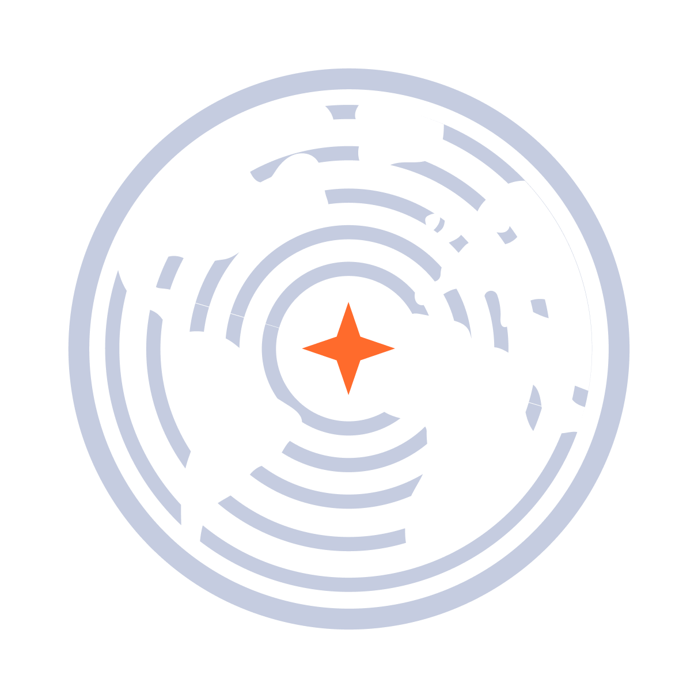

# Earth Jukebox

**Listening to Earth with a Brazilian accent.**

Real NASA observations, measured in your browser and played as music, so anyone can perceive a change on our planet by listening, not only by looking.

[**▶ Open the experience · earthjukebox.us**](https://earthjukebox.us)

<br />


NASA Space Apps Challenge 2026 · Challenge 14 "Earth Jukebox" · Enterprise track

</div>

<br />

> 🎧 **Best experienced with headphones.** Browsers only unlock audio after a gesture, so every experience starts with a tap.

---

## Contents

[The problem](#the-problem) · [Our answer](#our-answer) · [One rule for every phenomenon](#one-rule-for-every-phenomenon) · [The eleven experiences](#the-eleven-experiences) · [How it is measured](#how-it-is-measured) · [Accessibility](#accessibility) · [Honesty about the data](#honesty-about-the-data) · [Architecture](#architecture) · [Run it locally](#run-it-locally) · [Project structure](#project-structure) · [Team](#team) · [Use of AI](#use-of-ai) · [Data sources and references](#data-sources-and-references)

---

## The problem

NASA's Earth Information Center (EIC) publishes striking visualizations of a changing planet. They are almost all **visual only**, which limits who can read them and who can spot the patterns: blind and low-vision people, but also anyone who has never been taught to read a heat map.

The challenge asks for an "Earth Jukebox": an interface that pairs EIC visual frames with sonifications generated in real time. Our version of the question:

> **How do you make someone perceive a change on Earth without depending on vision alone?**

## Our answer

Earth Jukebox turns real events into a musical experience. What you **hear, see and feel** is generated live from NASA measurements. The sound is not a soundtrack laid on top: it *encodes* the data.

| Sense | What it does |
|---|---|
| **Hearing** | Notes, chords, tempo and 3D stereo position computed from the data |
| **Sight** | A real-globe 3D scene (or a flat map), timeline, cameras and a scroll narrative |
| **Touch** | Phone vibration with a distinct pattern per event |
| **Interaction** | Drag the timeline, switch cameras, pick a musical accent, operate everything by keyboard |
| **Language** | Voice narration of key moments; English, Português and Español |

## One rule for every phenomenon

Early prototypes mapped data straight to frequency. It worked like an alarm and sounded like a siren: pitch slid without ever landing on a note, and every phenomenon had its own logic. So we replaced it with a single musical rule shared by everything:

> **Intensity picks the note and the chord.**
> **Speed of change picks the tempo.**

- **Key:** A minor, two octaves (A2 to A4), 15 scale degrees. `degree = round(level × 14)`.
- **Chord:** stacked thirds on that degree (a seventh joins in some accents).
- **Tempo:** `BPM = 60 + speed × 90`, from 60 to 150.
- **Instruments** enter when a measurement crosses a scientific threshold of the phenomenon, such as the Saffir-Simpson hurricane categories or the 150, 300 and 450 km marks of the Tonga plume.

Learn it on one phenomenon and you can already listen to all the others.

### A Brazilian accent 🇧🇷

The same rule plays through different Brazilian rhythms. An alternative **universal** accent uses three synthesizers (pad, arpeggio, bass).

| Phenomenon | Accent |
|---|---|
| Hurricane Helene, aerosols, atmospheric river | **Baião** |
| Hunga Tonga, lightning, ocean currents | **Maracatu** |
| Night lights, atmospheric CO₂, air quality | **Samba** |
| Forest height, sea heat | **Bossa nova** |

Everything that follows the data is synthesized in the browser with Tone.js. Underneath it, listeners can optionally choose a **recorded background track** (baião, bossa nova, brega-funk, carimbó, maracatu, samba, xote or none), made with Suno. By default the one that matches the phenomenon plays.

## The eleven experiences

<table>
<tr>
<td align="center" width="25%">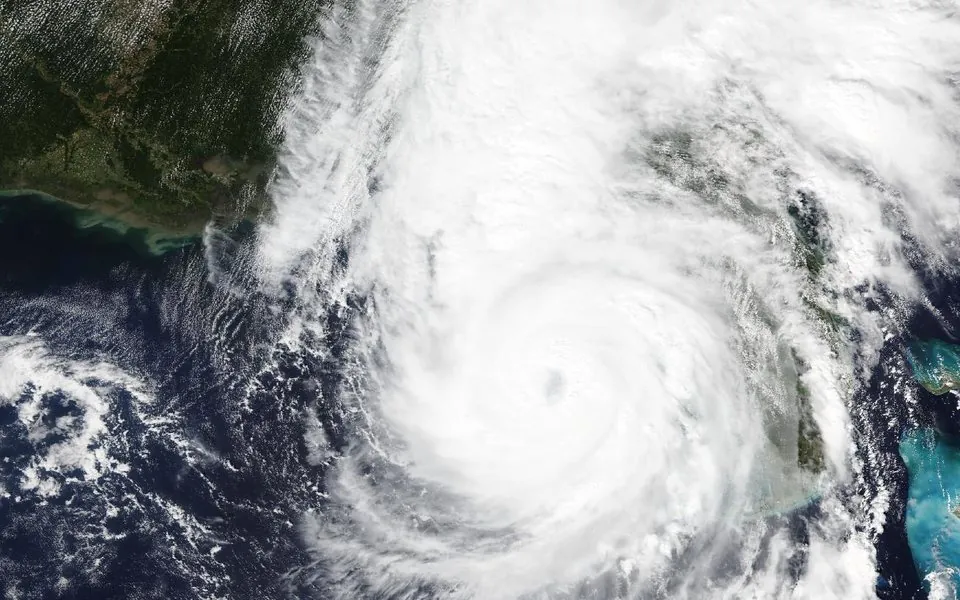<br /><b>Hurricane Helene</b><br /><sub>Sep 2024 · 3D</sub></td>
<td align="center" width="25%">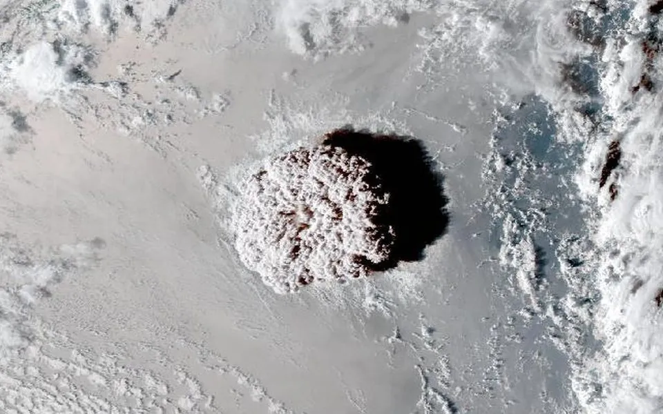<br /><b>Hunga Tonga</b><br /><sub>15 Jan 2022 · 3D</sub></td>
<td align="center" width="25%">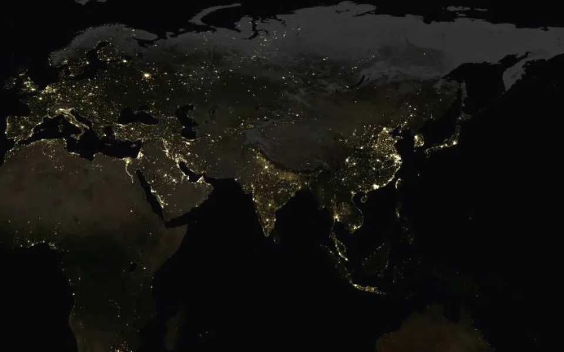<br /><b>Night lights</b><br /><sub>2012 to 2023 · 2D</sub></td>
<td align="center" width="25%">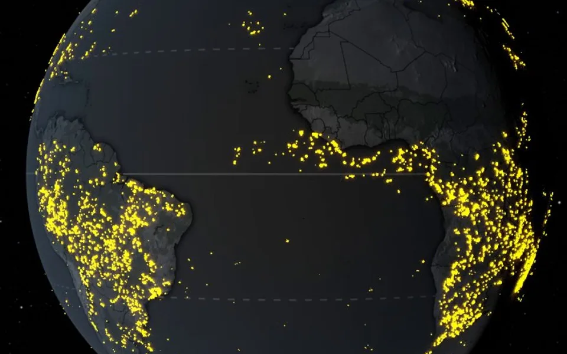<br /><b>Lightning from the ISS</b><br /><sub>2017 to 2023 · 2D</sub></td>
</tr>
<tr>
<td align="center">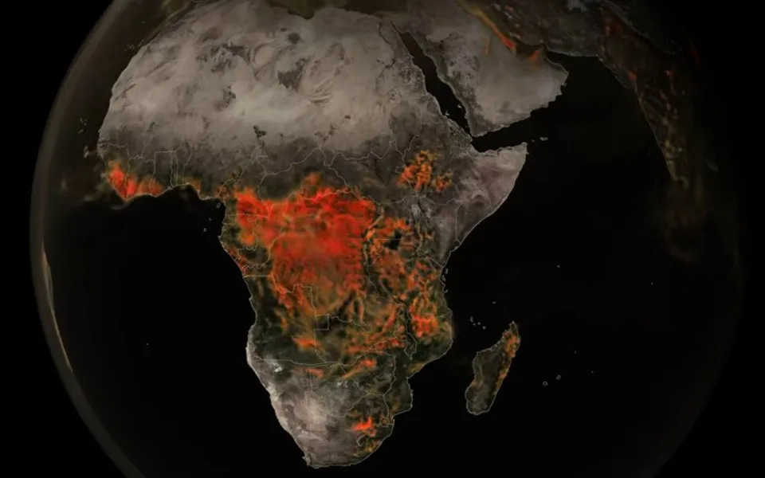<br /><b>Carbon in the air</b><br /><sub>Jan to Mar 2020 · 2D</sub></td>
<td align="center">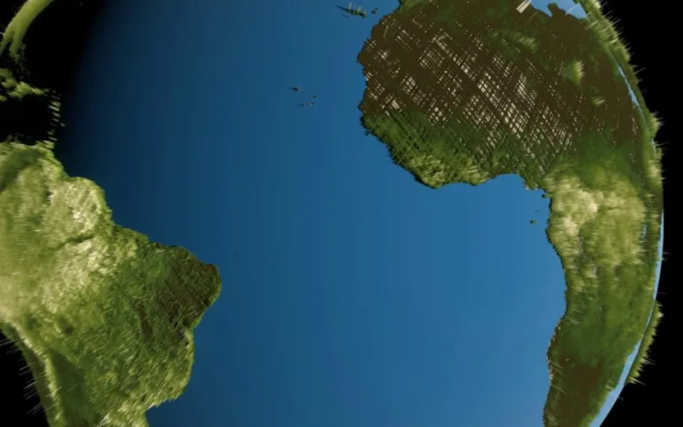<br /><b>Forest height</b><br /><sub>2019 to 2020 · 2D</sub></td>
<td align="center">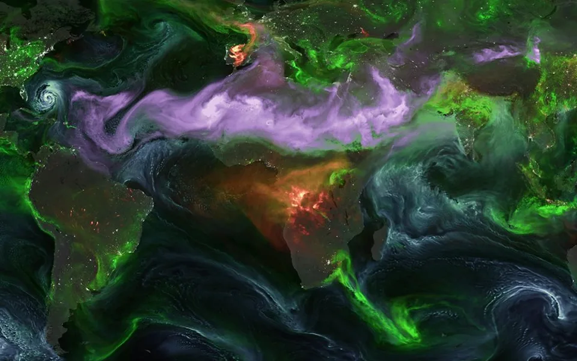<br /><b>Aerosols</b><br /><sub>19 Aug 2025 · 2D</sub></td>
<td align="center">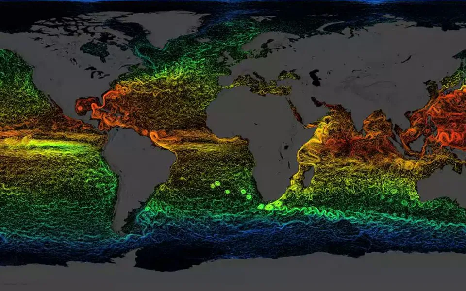<br /><b>Sea heat and currents</b><br /><sub>ECCO2 · 2D</sub></td>
</tr>
<tr>
<td align="center">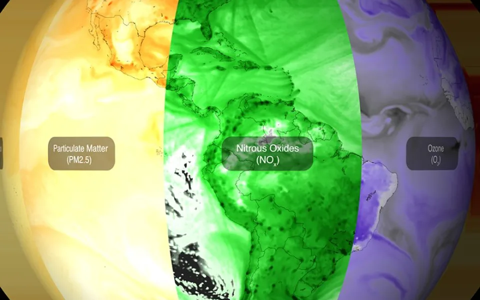<br /><b>Air we breathe</b><br /><sub>Jul to Aug 2024 · 2D</sub></td>
<td align="center">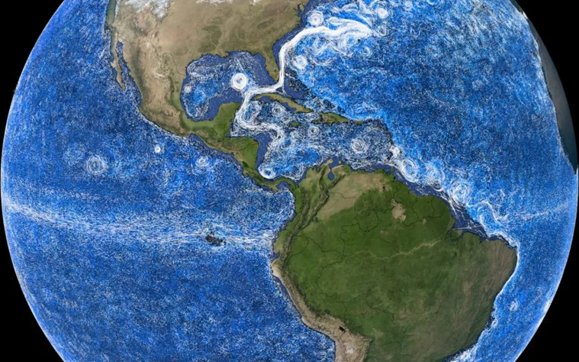<br /><b>Ocean currents</b><br /><sub>Perpetual Ocean 2 · 2D</sub></td>
<td align="center">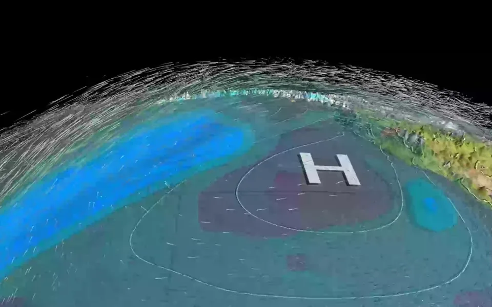<br /><b>Atmospheric river</b><br /><sub>MERRA-2 · 2D</sub></td>
<td></td>
</tr>
</table>

| Experience | Source | Intensity (picks the note) | Speed (picks the tempo) |
|---|---|---|---|
| **Hurricane Helene** | EONET `EONET_11304` + GIBS (NOAA-20, Aqua, Terra) | Sustained wind, 35 to 155 kt | The wind itself |
| **Hunga Tonga** | GIBS GOES-West infrared | Plume diameter, 0 to 750 km, **measured on the pixels** | Edge expansion, 0 to 6 km/min |
| **Night lights** | EIC · SVS 5313 (Black Marble / VIIRS) | Lit area of the map, 0.315% to 0.447%, **measured on the pixels** | Year-to-year change in lit area |
| **Lightning from the ISS** | EIC · SVS 5011 (LIS sensor) | Share of the globe covered by lightning | Change in that share |
| **Carbon in the air** | EIC · SVS 5196 (DYAMOND model) | Share of the globe with high CO₂ | Change in that share |
| **Forest height** | EIC · SVS 4950 (GEDI lidar) | Mean forest height in view, read from the colour bar | Change as the globe turns |
| **Aerosols** | EIC · SVS 5669 (GEOS model) | Map area in each aerosol type | Entry of each type |
| **Sea heat and currents** | EIC · SVS 3912 (ECCO2 model) | Map area in warm water | Change over the video |
| **Air we breathe** | EIC · SVS 5533 (GEOS-CF) | Frame area in each pollutant | Entry of each pollutant |
| **Ocean currents** | EIC · SVS 5425 (Perpetual Ocean 2) | Frame area in each current layer | Entry of each layer |
| **Atmospheric river** | EIC · SVS 4960 (MERRA-2) | Frame area in the water-vapour blue | Change over the video |

## How it is measured

Nothing is pre-computed for show. The browser measures the images at run time.

**Hunga Tonga plume** (`core/plume.js`). GOES-West frames are stitched across the antimeridian, then the plume is isolated from the infrared band: cold-top pixels are found around the vent, grown by flood fill (rejecting storms more than 8° away), and each pixel's area is accumulated in km². The equivalent diameter `2·√(area/π)` drives the note; the growth of the edge drives the tempo.

**Night lights** (`core/nightlights.js`). Each annual frame is read pixel by pixel: luminance above 60/255 counts as lit. A scan line crosses the map in 14 seconds and reads one 3.75° column every 120 ms. Every lit place rings a bell: **latitude picks the note, longitude picks the stereo side.** On the change map, purple (more light) rings high and orange (less light) falls to a low note that fades out.

**The other EIC frames** share one engine (`FramesModel`, `core/frames.js`): each experience defines pixel *kinds* by colour, measures the share of each, and sweeps a line over 88 columns.

**Hurricane physics** (`core/physics.js`). Wind pressure `q = ½·ρ·v²` with ρ = 1.15 kg/m³, relative destructive power `(kt/64)³` (Emanuel, 2005), rapid intensification flagged at +30 kt in 24 h (NHC criterion), and a modelled travel time of the Tonga Lamb wave (315 m/s) to São Paulo.

All the maths lives in pure functions under `src/models/`, with no DOM and no audio, and is shown with a live calculator on the in-app documentation page (`docs.html`).

## Accessibility

- **Sound as the primary channel**: the music encodes the data and makes sense with eyes closed.
- **Spoken narration** of key moments (ElevenLabs, with the browser voice as fallback).
- **Vibration** on phones, with a distinct pattern per event (on a computer the same pattern shakes the cursor).
- **Full keyboard operation**, a skip-to-content link on every page, and hidden text descriptions of each scene in three languages.
- **VLibras** (Brazilian Sign Language) and reading options in the header.
- Respects `prefers-reduced-motion`.

## Honesty about the data

The only brand commitment: **real NASA data only.** Everything else is labelled in the interface as *measured*, *calculated*, *model* or *illustrative*.

| Type | Examples |
|---|---|
| **Measured** | Wind (EONET), Tonga plume diameter and area, lit area, share of pixels per colour |
| **Calculated** | Wind pressure, destructive power, great-circle distances, "São Paulo states" comparisons |
| **Model** | Arrival of the Tonga pressure wave in São Paulo; CO₂ and aerosols are NASA model outputs |
| **Illustrative** | Lightning in the Helene and Tonga scenes (the ISS lightning experience is measured) |

Known limits, stated in the product too:

- EIC frames are **visualization images, not calibrated radiance**. The measurement compares one year with another; it is not a physical value.
- Lightning, CO₂ and forest experiences are spinning globes in the source video, so the measure describes **what is in view**, not a world value.
- We have **not** run user tests or measured accessibility with blind or low-vision people.

## Architecture

```
 NASA data                   Model                  Mapping              Output
 ───────────                 ─────                  ───────              ──────
 EONET (tracks, wind)   ┐    pure functions,         SensoryMapper        Three.js globe / Canvas 2D map
 GIBS (satellite)       ├──▶ no DOM, no audio  ──▶   data → level+speed ─▶ Tone.js: Brazil / Harmony layers
 EIC / SVS (frames)     ┘    pixel measurement       (the Jukebox rule)   Background track · Vibration
                             (plume, lights, kinds)                        Voice narration (/api/tts)
```

| Layer | Technology |
|---|---|
| Build | [Vite](https://vite.dev), one HTML page per experience, [Tailwind CSS v4](https://tailwindcss.com) |
| Scene | [Three.js](https://threejs.org) (real-globe 3D, adaptive resolution for integrated GPUs) and Canvas 2D |
| Audio | [Tone.js](https://tonejs.github.io/) on the Web Audio API; recorded tracks through a `GrainPlayer` |
| Motion and scales | GSAP, D3 |
| Voice | ElevenLabs through a small proxy so the key never reaches the browser |
| Pattern | Model (pure) · Controller · View |
| Backend | None for data. One function (`api/tts.js`) only proxies narration |
| Hosting | Vercel; `server/index.js` serves the proxy on your own server |
| Offline | Service worker for the site and `?local` mode for the data |

## Run it locally

Requires Node.js 20+.

```bash
git clone https://github.com/kritgarb/earthjukebox.git
cd earthjukebox
npm install
npm run dev
```

Open the address Vite prints.

**Poor connection?** Add `?local` to any page address (for example `/helene.html?local`) to run entirely from saved copies of the real NASA responses in `public/data/`, `public/img/gibs/` and `public/img/eic/`.

### Voice narration (optional)

Narration goes through `/api/tts`. Without a key the site falls back to the browser's own voice.

```bash
cp .env.example .env
```

| Variable | Purpose |
|---|---|
| `ELEVENLABS_API_KEY` | ElevenLabs key (server side only, never commit it) |
| `ELEVENLABS_VOICE_ID` | Voice to use |
| `ELEVENLABS_MODEL_ID` | Optional. Defaults to `eleven_flash_v2_5` |

The same handler runs in the Vite dev server, as a Vercel function, and as a standalone Node server for self-hosting behind a reverse proxy:

```bash
ELEVENLABS_API_KEY=... ELEVENLABS_VOICE_ID=... PORT=8787 node server/index.js
```

### Build

```bash
npm run build
npm run preview
```

## Project structure

```
├── index.html · helene.html · tonga.html · nightlights.html · eic.html · docs.html
├── src/
│   ├── config/        the real events behind each experience (ids, dates, regions)
│   ├── models/        pure models and core/ (music rule, accents, physics, pixel measurement)
│   ├── controllers/   connect model, view and audio; announce milestones
│   ├── views/         scenes, sensory layer (audio engine, vibration, narrator), shared UI
│   ├── components/    header, carousel, scroll narrator
│   ├── i18n/          English, Português, Español
│   ├── main/          entry point per page
│   ├── styles/        tokens, base, components, accessibility
│   └── workers/       frame composition worker
├── public/
│   ├── data/          EONET responses and measured EIC series
│   ├── img/           GIBS and EIC frames, cards, logo
│   ├── audio/rhythms/ background tracks and manifest
│   └── sw.js          service worker
├── api/tts.js         Vercel function for narration
└── server/            standalone narration server
```

`eic.html` runs eight of the experiences, selected with `?e=` (`lightning`, `co2`, `gedi`, `aerosols`, `sst`, `airquality`, `ocean`, `river`).

## Team

Five people on the Enterprise track.

| | Role | Links |
|---|---|---|
| **Benjamin** | Developer and tech lead | [LinkedIn](https://www.linkedin.com/in/benjamdev) · [Instagram](https://www.instagram.com/fatherofcode) · [Website](https://bendevsolutions.com) |
| **Maria** | Software developer | [LinkedIn](https://linkedin.com/in/malufmatos) · [GitHub](https://github.com/malufmatos) · [Website](https://malufmatos.dev) |
| **Gabryel** | Graphic designer and illustrator | [LinkedIn](https://www.linkedin.com/in/gabryel-batista-designer) · [Behance](https://www.behance.net/gabbatsart) |
| **Isabela Guedes** | UI/UX designer | [LinkedIn](https://www.linkedin.com/in/isabela-guedes-337b13212) · [Portfolio](https://faint-increase-3bb.notion.site/Isabela-Guedes-ux-ui-designer-portfolio-c6d300a1b784822788f0018bd56e6ea9) |
| **Cassio** | Data analyst | |
| **Vitória** | QA | |

## Use of AI

- **Code** was written with Claude Code (Anthropic).
- **Voice narration** is generated with ElevenLabs.
- **Background music tracks** (baião, bossa nova, brega-funk, carimbó, maracatu, samba, xote) were generated with Suno. The sounds that follow the NASA data are synthesized in the browser.
- No NASA logos, flags or mission identifiers were generated or modified.

## Data sources and references

**NASA**
[GIBS](https://gibs.earthdata.nasa.gov/) · [EONET](https://eonet.gsfc.nasa.gov/) · [Earth Information Center](https://earth.gov/) · [Earthdata](https://www.earthdata.nasa.gov/)

SVS visualizations: [5313 night lights](https://svs.gsfc.nasa.gov/5313/) · [5011 lightning](https://svs.gsfc.nasa.gov/5011/) · [5196 carbon](https://svs.gsfc.nasa.gov/5196/) · [4950 forest height](https://svs.gsfc.nasa.gov/4950/) · [5669 aerosols](https://svs.gsfc.nasa.gov/5669/) · [3912 sea heat](https://svs.gsfc.nasa.gov/3912/) · [5533 air quality](https://svs.gsfc.nasa.gov/5533/) · [5425 ocean currents](https://svs.gsfc.nasa.gov/5425/) · [4960 atmospheric river](https://svs.gsfc.nasa.gov/4960/)

**Science**
- Matoza et al., *Science*, 2022: the Hunga Tonga Lamb wave.
- Proud et al., *Science*, 2022: the 57 km plume height.
- Emanuel, *Nature*, 2005: destructive power of tropical cyclones.
- US National Hurricane Center: rapid intensification criterion and Helene landfall.
- Dubus and Bresin, *PLoS ONE*, 2013, and Spence, 2011: sound mappings.

**Tools**
[Three.js](https://threejs.org/) · [Tone.js](https://tonejs.github.io/) · [D3](https://d3js.org/) · [GSAP](https://gsap.com/) · [Web Audio API](https://developer.mozilla.org/en-US/docs/Web/API/Web_Audio_API) · [ElevenLabs](https://elevenlabs.io/) · [VLibras](https://vlibras.gov.br/)

---

<div align="center">

Built for the **NASA Space Apps Challenge 2026**. This project is not affiliated with or endorsed by NASA.

**🎧 [earthjukebox.us](https://earthjukebox.us)**

</div>
